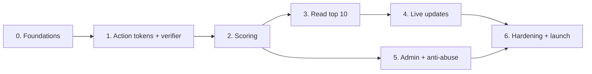

# Scoreboard Module — Implementation Plan

This plan breaks [README.md](./README.md) (the spec) into phases the team can build and ship one at a time. Each phase lists what to build, which spec sections it covers, and when it counts as done. Core behaviour is written as Cucumber scenarios in [features/](./features/); the rest is the README §6 checklist.

## Phases at a glance

| Phase | Goal | Scenarios | Size | Can ship to users? |
|---|---|---|---|---|
| 0 | Schema, Redis, errors, config | — | S | No |
| 1 | `POST /actions/start`, token checks, `ActionVerifier` | — | M | No |
| 2 | `POST /actions`: award points safely | US-01, US-02 | L | Yes: scores grow, nothing to see yet |
| 3 | `GET /scoreboard` + Redis/Postgres sync | — | S | Yes: static top 10 |
| 4 | Live updates over SSE | US-03 | M | Yes: **meets all 5 requirements** |
| 5 | Admin endpoints, rate limits, anomaly job | — | M | Yes |
| 6 | Observability, load test, failure drills | — | M | Launch |

Size: S ≈ 1–3 dev-days, M ≈ 3–5, L ≈ 5–10. Auth is the platform's existing session/JWT middleware; if there is none, add the optional [Appendix A](./appendix/auth.md) design as an extra phase before phase 1.

**Parallel work:** phase 5 can run alongside phases 3–4.

---

## Phase 0 — Foundations

**Spec:** §2.5, §5.1, §5.2

**Build:**
- [ ] Postgres migrations for `scores`, `score_events`, `action_runs`. The app's DB role has no `UPDATE` or `DELETE` on `score_events`.
- [ ] Redis client; check at startup that Redis is 6.2+ (needed for `ZADD GT`).
- [ ] Error middleware returning `{ error: { code, message, requestId } }`, with a `requestId` on every request and log line.
- [ ] Config from env: `ACTION_POINTS`, `ACTION_MIN_DURATION`, `ACTION_TOKEN_TTL`, `ACTION_COOLDOWN`, `ACTION_DAILY_CAP`, the verifier choice, validated at startup.
- [ ] The action-token key from the secret manager, with a `kid`.

**Done when:**
- [ ] Migrations run up and down on a clean database.
- [ ] The app refuses to start with invalid config, a missing key, no verifier, or Redis older than 6.2.

---

## Phase 1 — Action tokens and verifier

**Spec:** §2.1, §2.2 (verifier), §3.2

**Build:**
- [ ] `POST /actions/start`: PASETO v4.local token with `jti`, `sub`, `iat`, `exp`, `kid` footer.
- [ ] Token check used by `POST /actions`: decrypt by `kid`, `iss`/`aud`, `sub` = caller (expiry is checked later, after the claim).
- [ ] `ActionVerifier` interface, `ServerRecordVerifier` (reads `action_runs`), `SignedResultVerifier` (Ed25519 keys by `kid`). 2 s timeout.
- [ ] Contract with the action service: it writes `action_runs` with the token's `jti`.

**Done when:**
- [ ] Unit tests: tampered, foreign-user, wrong-key tokens fail; key rotation lets old tokens finish.
- [ ] Verifier tests cover: no run, unfinished run, other user's run, `runId` mismatch, finished too early, timeout.

---

## Phase 2 — Scoring

**Spec:** §2.2 steps 1–9, §5.1 (completion transaction), §5.4

**Build:**
- [ ] `POST /actions`, following §2.2 steps 1–9:
  - **Claim** with `SET action:{userId}:{jti} processing NX EX 30`; existing key → 409 or the stored response.
  - Expired → store 403 `TOKEN_EXPIRED`; too quick → store 422 `TOO_QUICK`.
  - Verifier rejects → store 422 `PROOF_REJECTED`; verifier error → delete the claim, 503.
  - Completion transaction: `FOR UPDATE` on `scores`, cooldown, daily cap, insert `score_events`, update `scores`. Cooldown/cap hit → store the 429.
  - Duplicate `(user_id, action_id)` → success with the original `delta`.
  - Other DB error → delete the claim, 503.
  - After commit: flagged → `ZREM`, else `scoreboard.publishIfChanged(userId, score)` (plain `ZADD GT` stub until phase 4).
  - Store the 200 for 24 h.

**Done when:** US-01 and US-02 pass, including:
- [ ] 50 parallel requests with one token → exactly one `score_events` row.
- [ ] 20 tokens cashed in at once → one award, the rest 429 `TOO_FAST`.
- [ ] Reply dropped after commit, then retry → the same 200 and one row, even after a Redis flush.
- [ ] Killing the process while a token is `processing` → retryable after 30 s.

**Risk:** this phase holds most of the correctness. Write the concurrency tests before the handler and run them against real Postgres and Redis, not mocks.

---

## Phase 3 — Read the top 10

**Spec:** §2.3, §5.3

**Build:**
- [ ] `GET /scoreboard`: `ZREVRANGE 0 9 WITHSCORES` + names from `user:name:{userId}` (misses filled from Postgres) + `version`. No `userId` in responses.
- [ ] Rebuild job at startup and every 5 min: build a temp key from `scores WHERE NOT flagged`, then `RENAME`.
- [ ] Redis down → read Postgres, cache 5 s.

**Done when:**
- [ ] The response matches `SELECT … WHERE NOT flagged ORDER BY score DESC, user_id DESC LIMIT 10`.
- [ ] After flushing Redis and running the rebuild, the top 10 is identical.

---

## Phase 4 — Live updates

**Spec:** §2.4, §4

**Build:**
- [ ] Extend the phase-2 stub: after `ZADD GT`, if `ZREVRANK` < 10 then `INCR` the version and `PUBLISH`.
- [ ] `GET /scoreboard/stream`: snapshot on connect, ping every 25 s, per-IP cap, fresh snapshot on reconnect.
- [ ] One subscriber per instance on `scoreboard:updates`; at most one event per 500 ms, newest version wins.
- [ ] Version poll every 10 s as the safety net.
- [ ] Display name change of a top-10 user → bump + publish.

**Done when:** US-03 passes, including a change on instance A reaching an SSE client on B, and out-of-order writes leaving the higher score.

**Milestone: all 5 requirements are met.** This phase can be demoed and released.

---

## Phase 5 — Admin and anti-abuse

**Spec:** §3.1 (admin endpoints), §3.3

**Build:**
- [ ] `POST /admin/users/{id}/flag`, `/adjust`, `/ban` as in §3.1, each written to the audit log.
- [ ] Rate limits: Redis token bucket on `rl:{route}:{userId|ip}` with the §3.3 defaults; `Retry-After` on 429.
- [ ] Anomaly job: flag accounts with inhumanly regular timing or that hit the daily cap 3 days in a row.

**Done when:** the matching §6 checklist items pass (extra scenarios: [appendix/features/](./appendix/features/)).

---

## Phase 6 — Hardening and launch

**Spec:** §5.4, §6

**Build:**
- [ ] Metrics and alerts from §6.
- [ ] Load test: 500 completions/s at p95 < 150 ms; 10k SSE clients per instance.
- [ ] Failure drills for every row of the §5.4 table.
- [ ] LB idle timeout above 25 s; runbook for rotating the token key.

**Done when:**
- [ ] The full §6 acceptance checklist passes.
- [ ] Every drill behaves as §5.4 says.

---

## Definition of done (every phase)

- The phase's scenarios / checklist items pass in CI against real Postgres and Redis.
- No endpoint lets the client choose the points.
- Logs carry `requestId`, `userId`, `actionId`; tokens and secrets never appear in logs.
- Spec updated if the implementation had to change anything.
