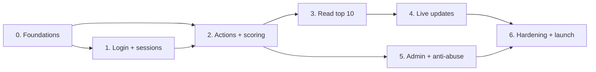

# Scoreboard Module — Implementation Plan

This plan breaks [README.md](./README.md) (the spec) into phases the team can build and ship one at a time. Each phase lists what to build, which spec sections it covers, and when it counts as done. The behaviour each phase must pass is written as user stories (one Cucumber feature file per story) in [features/](./features/). Run a phase's tagged scenarios (for example `--tags @phase-2`) to check it.

## Phases at a glance

| Phase | Goal | User stories | Size | Can ship to users? |
|---|---|---|---|---|
| 0 | Foundations: schema, Redis, errors, action config | — | S | No |
| 1 | Passkey login, sessions, auth middleware | US-01, US-02 | L | Yes: login only |
| 2 | `POST /actions`: award points safely | US-03, US-04, US-05 | L | Yes: scores grow, nothing to see yet |
| 3 | `GET /scoreboard` + Redis/Postgres sync | US-06 | S | Yes: static top 10 |
| 4 | Live updates over SSE | US-07 | M | Yes: **meets all 5 requirements** |
| 5 | Admin endpoints, rate limits, anomaly job | US-08, US-09 | M | Yes |
| 6 | Observability, load test, failure drills | — | M | Launch |

Size: S ≈ 1–3 dev-days, M ≈ 3–5, L ≈ 5–10.

**Parallel work:** phase 2 doesn't need to wait for phase 1. Build it against a test-only middleware that puts `{ userId, role }` on the request, then switch to the real middleware once phase 1 merges. Phase 5 can run alongside phases 3–4.

---

## Phase 0 — Foundations

**Spec:** §2.4, §5.1, §5.2

**Build:**
- [ ] Postgres migrations for `users`, `passkey_credentials`, `scores`, `score_events`. The app's database role must have no `UPDATE` or `DELETE` on `score_events`.
- [ ] Redis client.
- [ ] Error middleware that returns `{ error: { code, message, requestId } }`, plus a `requestId` on every request and log line.
- [ ] Action config from env: `ACTION_POINTS`, `ACTION_COOLDOWN`, `ACTION_DAILY_CAP`, checked at startup.
- [ ] The PASETO key loaded from the secret manager, with a `kid`.
- [ ] Check at startup that Redis is version 6.2 or later (needed for `ZADD GT` in phase 4).

**Done when:**
- [ ] Migrations run up and down on a clean database.
- [ ] An unknown route returns the standard error shape with a `requestId`.
- [ ] The app refuses to start with invalid action config, a missing secret or Redis older than 6.2.

---

## Phase 1 — Login and sessions

**Spec:** §3.1, §3.2, §3.3 (the role checks)

**Build:**
- [ ] `POST /auth/register/{options,verify}` and `POST /auth/login/{options,verify}` using `@simplewebauthn/server`. Challenges live in Redis for 5 min and are read once with `GETDEL`.
- [ ] Session creation: a random `sid`, the record `session:{sid}`, the index `user:sessions:{userId}`, and the cookie `__Host-session` holding a PASETO v4.local token with `iss`, `aud`, `sub`, `sid` and `exp`. The cookie lasts 30 min.
- [ ] Auth middleware, steps 1–7 of §3.2: Origin check, PASETO, session lookup, `banned_users` check, idle refresh, re-issuing the cookie when less than 15 min is left, and the 12 h hard limit.
- [ ] `POST /auth/logout` and `POST /auth/logout-all`.
- [ ] Role guard: `requireRole('admin')` plus `requireRecentPasskey(5 min)`, which uses the session's `authTime` and `amr`.

**Done when:** the `@phase-1` scenarios pass, covering:
- [ ] No cookie, a tampered or expired cookie, or a revoked session → 401.
- [ ] Foreign `Origin` on a POST → 403.
- [ ] Idle for 31 min → 401; active for 12 h → 401 at 12 h.
- [ ] A user in `banned_users` → 403, even with a live session.

**Risk:** WebAuthn setup (RP ID, origin) differs between local, staging and production. Configure it per environment from day one.

---

## Phase 2 — Actions and scoring

**Spec:** §2.1, §5.1 (the completion transaction), §5.4

**Build:**
- [ ] `POST /actions`, following steps 1–7 of §2.1:
  - Validate the body: `actionId` must be a UUID. Ignore every other field except `proof`.
  - **Claim** with `SET action:{userId}:{actionId} processing NX EX 30`. If the key exists: `processing` → 409, otherwise return the stored response.
  - Proof check fails → store `rejected` with the 422.
  - Completion transaction: `FOR UPDATE` on the user's `scores` row, cooldown check on `last_action_at`, daily-cap sum, insert into `score_events`, update `scores`. Cooldown or cap hit → store `rejected` with the 429.
  - Duplicate `(user_id, action_id)` → treat as success and return the original `delta` and the current score.
  - Other database error → delete the claim and return 503.
  - After commit, a flagged user → `ZREM`. Otherwise call `scoreboard.publishIfChanged(userId, score)`. This is a plain `ZADD GT` stub until phase 4.
  - Store `completed` with the 200 response for 24 h.
- [ ] Proof validator hook. The default validator accepts everything.

**Done when:** the `@phase-2` scenarios pass, covering:
- [ ] 50 parallel requests with the same `actionId` → exactly one row in `score_events`.
- [ ] 20 parallel requests with different `actionId`s by one user → one award, the rest 429 `TOO_FAST`.
- [ ] Dropping the reply after commit, then retrying → the same 200 and one row, even after a Redis flush.
- [ ] A request within the cooldown → 429, and retrying it returns the same 429.
- [ ] Killing the process while an `actionId` is `processing` → it can be retried after 30 s.

**Risk:** this phase holds most of the correctness. Write the concurrency tests before the handler, and run them against real Postgres and Redis, not mocks.

---

## Phase 3 — Read the top 10

**Spec:** §2.2, §5.3

**Build:**
- [ ] `GET /scoreboard`: run `ZREVRANGE 0 9 WITHSCORES`, add display names from `user:name:{userId}` (fill misses from Postgres), and return `version`. Responses contain no `userId`.
- [ ] Rebuild job: load `scores WHERE NOT flagged` into `scoreboard` and banned users into `banned_users`. It runs at startup and every 5 min. The swap must be atomic: build a temporary key, then `RENAME`.
- [ ] Fallback: if Redis is down, read the top 10 from Postgres and cache the result for 5 s.

**Done when:** the `@phase-3` scenarios pass, covering:
- [ ] The response matches `SELECT … WHERE NOT flagged ORDER BY score DESC, user_id DESC LIMIT 10`.
- [ ] After flushing Redis and running the rebuild, the top 10 is identical.
- [ ] No public response contains an internal `userId`.

---

## Phase 4 — Live updates

**Spec:** §2.3, §4

**Build:**
- [ ] Extend the phase-2 stub per §4: after `ZADD GT`, if `ZREVRANK` < 10 then `INCR` the version and `PUBLISH`.
- [ ] `GET /scoreboard/stream`:
  - Sends a snapshot as soon as a client connects.
  - Pings every 25 s.
  - Limits connections per IP.
  - Ignores `Last-Event-ID` and sends a fresh snapshot instead.
- [ ] One Redis subscriber per instance on `scoreboard:updates`. It fans out to that instance's SSE clients and sends at most one event per 500 ms, keeping the newest version.
- [ ] Every 10 s, each instance compares `scoreboard:version` with the last version it sent and resends if it is behind.
- [ ] When a display name changes for a user in the top 10 → bump the version and publish.

**Done when:** the `@phase-4` scenarios pass, covering:
- [ ] Snapshot on connect, an event within 1 s of a top-10 change, and no event for changes outside the top 10.
- [ ] With 2 instances, a change on A reaches an SSE client on B.
- [ ] Two writes for the same user arriving out of order leave the higher score in Redis.

**Milestone: all 5 requirements are met.** This phase can be demoed and released.

---

## Phase 5 — Admin and anti-abuse

**Spec:** §3.3 (admin endpoints), §3.4

**Build:**
- [ ] `POST /admin/users/{id}/flag`, `/adjust` and `/ban`, as specified in §3.3. Each needs an admin with a recent passkey login and writes to the audit log.
- [ ] Rate limits: a Redis token bucket on `rl:{route}:{userId|ip}`, with the §3.4 defaults, including the per-IP limit on the public `GET /scoreboard` (no login). Responses carry `Retry-After`.
- [ ] Anomaly job: flag accounts with inhumanly regular timing, or that hit the daily cap 3 days in a row. Flagged users are hidden from the top 10.

**Done when:** the `@phase-5` scenarios pass, covering:
- [ ] Non-admin → 403; an admin whose passkey login is stale → 403 `REAUTH_REQUIRED`.
- [ ] A ban ends all of that user's sessions, and the user drops out of the top 10.
- [ ] An adjustment that lowers a score is reflected in the top 10.
- [ ] Going over the rate limit → 429 with `Retry-After`.

---

## Phase 6 — Hardening and launch

**Spec:** §5.4, §6

**Build:**
- [ ] Metrics: `actions_completed_total{result}`, `rejections_total{code}`, `scoreboard_broadcasts_total`, `sse_connections`, and the p95 latency of `POST /actions`.
- [ ] Alerts on rejection spikes and on drift between Redis and Postgres (compare the top 10 every 5 min).
- [ ] Load test: 500 completions/s with p95 under 150 ms, and 10k SSE clients per instance.
- [ ] Failure drills: Redis down, Postgres down, instance killed while an action is `processing`, a lost pub/sub message.
- [ ] Load balancer idle timeout above 25 s; runbook for rotating secrets.

**Done when:**
- [ ] The full acceptance checklist in §6 passes.
- [ ] Every drill behaves as the §5.4 table says.
- [ ] Load targets are met on production-sized hardware.

---

## Definition of done (every phase)

- The phase's `@phase-N` scenarios pass in CI against real Postgres and Redis. Phases 0 and 6 have no scenarios; their "Done when" lists are the check.
- No endpoint lets the client choose the points (reviewer checklist item).
- Logs carry `requestId`, `userId` and `actionId`; no secrets or tokens appear in logs.
- Spec updated if the implementation had to change anything.
