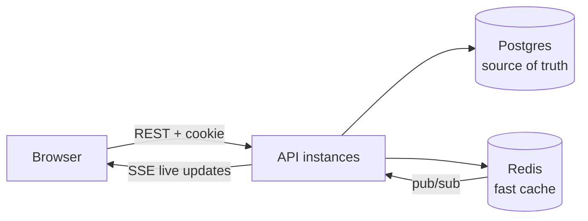
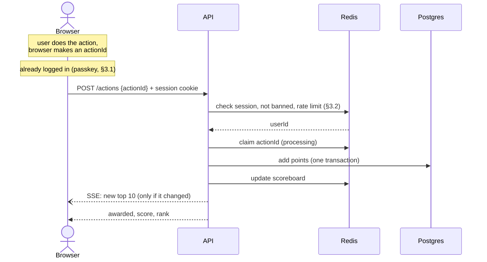
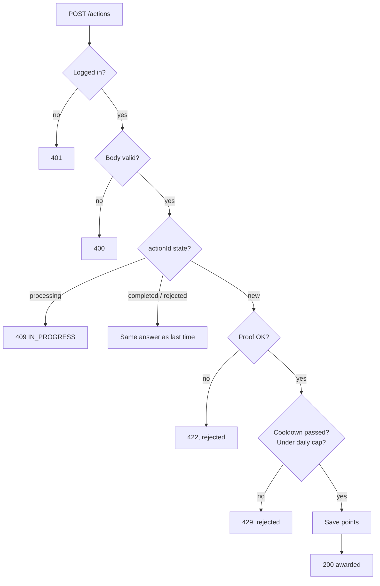
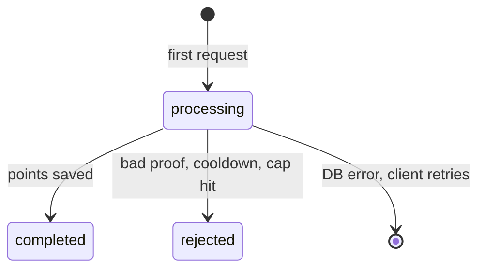
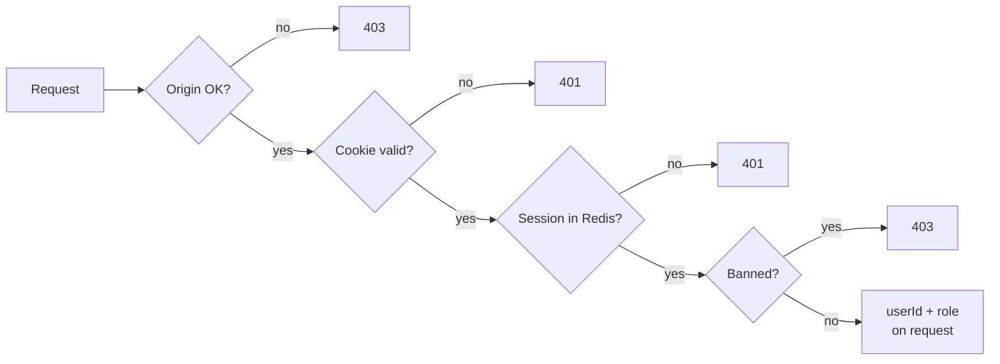
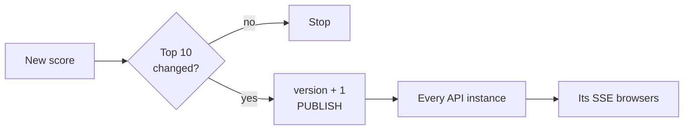
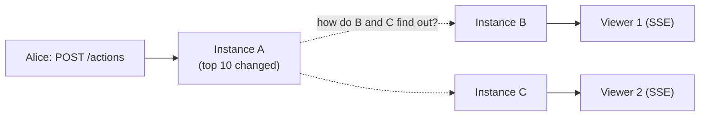

# Scoreboard Module — Specification

A backend module for the API server that stores user scores, serves the **top-10 scoreboard**, pushes **live updates** to browsers, and makes sure **nobody can raise a score without permission**.

**Companion docs:** [IMPLEMENTATION_PLAN.md](./IMPLEMENTATION_PLAN.md) (build phases) · [features/](./features/) (user stories in Cucumber format) · [Glossary](#8-glossary) (short explanations of every less common term)

## TL;DR

| Requirement | How we meet it |
|---|---|
| Show the top 10 scores | `GET /scoreboard`, read from a Redis sorted set (§2.2) |
| Live updates | `GET /scoreboard/stream` (Server-Sent Events), pushed only when the top 10 changes (§4) |
| An action increases the score | **One call** when the action is done: `POST /actions` with a client-made `actionId` (§2.1) |
| Block unauthorised score increases | Logged-in session required, the client **never sends a score**, each `actionId` counts **once** per user, cooldown + daily cap (§3) |

**The one rule to remember:** the client never says how many points it gets. The server decides.

**Why so much auth?** Requirement 5 ("prevent unauthorised score increases") is the core risk, so this spec covers authentication and authorisation end to end, not just the score logic.

---

## 1. How it works (the big picture)

**The pieces**



**The happy path** (each failure case is in §2.1)



**Storage roles:** Postgres is the source of truth (users, scores, audit log). Redis is a fast cache that can always be rebuilt from Postgres.

**In scope:** score storage and audit trail, the completion endpoint, top-10 read and live stream, login/sessions, anti-abuse.
**Out of scope:** what the "action" actually is, profile UI, frontend rendering, sending emails.

### 1.1 Key design choices

#### Why Redis, not just querying Postgres?

Postgres alone *could* serve the top 10: `SELECT … WHERE NOT flagged ORDER BY score DESC LIMIT 10` with an index on `score` is fast. We still add Redis because of how the scoreboard is used, not because of that one query:

| Need | Postgres only | With Redis |
|---|---|---|
| Read the top 10 on every page view and every SSE reconnect | One query each time; read load grows with visitors | `ZREVRANGE` from memory, sub-ms, no DB load |
| After each score write, check "did the top 10 change?" | A second query per write | `ZREVRANK` on the sorted set, O(log N) (§4) |
| Tell every API instance about a change | `LISTEN/NOTIFY` works, but holds a DB connection per instance and has payload limits | Built-in pub/sub |
| Short-lived state: sessions, action claims, rate limits, login challenges | Extra tables, cleanup jobs, row churn on hot paths | Native TTLs, `SET NX`, `GETDEL` |
| Keep the DB for writes | Every read competes with the completion transaction | Reads never touch Postgres |

**Trade-offs we accept:**
- One more system to run and monitor.
- Redis and Postgres can drift. Postgres stays the **source of truth**: Redis gets the absolute score (`ZADD GT`), and a rebuild job re-syncs it every 5 min (§5.3).
- Redis is not durable storage. Losing it loses no points, only cached state (users must log in again; open action claims are retried and the DB unique key prevents a double award).
- If Redis is down, writes fail closed and reads fall back to Postgres (§5.4).

**When to skip Redis:** a single instance with low traffic. Postgres with the index above plus an in-process cache is enough, and the rest of this spec still applies.

#### Why Server-Sent Events, not WebSocket?

| | SSE (chosen) | WebSocket | Polling `GET /scoreboard` |
|---|---|---|---|
| Direction | Server → browser | Both ways | Browser asks |
| What we need | Push the top 10 to viewers; they never send anything back | Unused half | Works, but always late or wasteful |
| Protocol | Plain HTTP response | Upgrade to a separate protocol | Plain HTTP |
| LB, proxies, CDN, auth | Work as-is | Need upgrade support and longer timeouts; own auth handshake | Work as-is |
| Reconnect | Built into `EventSource`, sends `Last-Event-ID` | Write it yourself | N/A |
| Server cost | One open connection per viewer, idle unless the top 10 changes | Same, plus per-message framing and ping/pong | A request every N seconds per viewer, even with no change |
| Latency | Under 1 s | Under 1 s | Up to N seconds |
| Limits | Text only; max 6 connections per domain on HTTP/1.1 (none on HTTP/2) | Binary support; no per-domain cap | — |

**Why SSE wins here:** the data flows one way, it is small (10 rows), and it is public. SSE gives live updates with the least new infrastructure and free reconnects. Scores are still sent with normal `POST` requests, which already have session, Origin check and rate limits.

**Trade-offs we accept:**
- Each viewer holds an open connection. We cap connections per IP and send a ping every 25 s so proxies keep it open.
- Browsers on HTTP/1.1 allow 6 connections per domain, so many tabs can starve each other. Serve the API over HTTP/2.
- No client → server channel. That is fine today.

**When to switch to WebSocket:** if the page needs to send frequent messages back (chat, real-time game input), or binary data. Polling stays a fallback for clients that cannot keep a connection open.

---

## 2. API

All endpoints live under `/api/v1` and use JSON. Except `/auth/*`, `GET /scoreboard` and the stream, every request needs a valid session cookie (§3.1).

### 2.1 `POST /actions` — an action was completed, award points (logged in)

```json
// request (proof is optional)
{ "actionId": "0192f1c4-7a2b-7c3d-9e8f-0a1b2c3d4e5f", "proof": {} }
// response 200
{ "actionId": "0192f1c4-…", "awarded": 10, "score": 1240, "rank": 7 }
```
`rank` is `null` if the user is outside the top 10.

**`actionId` — which action is this?**
- A unique ID for one finished action, like an order number on a receipt.
- Same action → same ID, even if the request is sent again. New action → new ID.
- Why we need it: if a request is sent twice (e.g. the network dropped the reply), the server sees the same ID and knows it is a repeat, not a new action. So one action is paid **only once**.
- The browser makes it (a random UUID) when the action finishes, and reuses it on every retry:
  ```js
  // frontend: crypto.randomUUID() is built into every modern browser, no library needed
  async function submitAction(proof) {
    const actionId = crypto.randomUUID();        // made ONCE per action
    for (let attempt = 0; attempt < 3; attempt++) {
      try {
        const res = await fetch('/api/v1/actions', {
          method: 'POST',
          credentials: 'include',                 // sends the session cookie
          headers: { 'Content-Type': 'application/json' },
          body: JSON.stringify({ actionId, proof }), // same actionId on every retry
        });
        if (res.status !== 409 && res.status < 500) return res.json(); // done (success or final error)
      } catch {}                                  // network error → retry
      await new Promise(r => setTimeout(r, 1000 * 2 ** attempt));
    }
    throw new Error('Could not submit action, please try again');
  }
  ```
- Why the browser, not the server? The ID must exist **before** the first request, so a retry can carry the same one. An ID the server makes on each request would be new on the retry too, and it would pay twice. An ID from the session would be the same for every action, so a second real action would look like a retry and get nothing.
- Is that safe? Yes. The ID only answers "repeat or new?". A cheater who invents new IDs just gets new actions, which still face the cooldown, daily cap and rate limit. IDs are checked per user, so using someone else's ID does nothing to their score.

**Points and limits — set by the server, not the browser**

The request has **no** field for points. The server decides using three settings:

| Setting | Default | Meaning |
|---|---|---|
| `ACTION_POINTS` | 10 | Points for each action |
| `ACTION_COOLDOWN` | 5 s | Minimum wait between two paid actions |
| `ACTION_DAILY_CAP` | 100 | Most points a user can earn per day (UTC) |

**`proof` — evidence the action really happened (optional)**
- The server runs a check function on it. If the check fails, no points.
- For now the check accepts anything. To make it real, see §7, item 1.

**Every outcome of a completion:**



**Life of an `actionId`** (stored in Redis as `action:{userId}:{actionId}`):



Server steps, **in this order**:
1. Session middleware (§3.2) gives us `userId`. Rate limit (§3.4) → else 429 `RATE_LIMITED`.
2. Validate the body: `actionId` must be a UUID → else 400 `INVALID_REQUEST`. Unknown fields are ignored.
3. **Claim it** with one plain command: `SET action:{userId}:{actionId} processing NX EX 30`.
   - `OK` → we own it for 30 s, continue. (After a crash the key simply expires, so the client can retry.)
   - `nil` (key exists) → `GET` it: `processing` → 409 `ACTION_IN_PROGRESS`; otherwise it holds the stored response for `completed` / `rejected` → return it (safe retry).
   - Storing a result later = `SET action:{userId}:{actionId} <response> EX 86400`.
4. `proof` validator fails → set `rejected` + store the 422 `PROOF_REJECTED`, return it.
5. Postgres transaction (§5.1): lock the user's row, check cooldown and daily cap, insert `score_events`, add points.
   - Cooldown not passed → set `rejected` + store the 429 `TOO_FAST`, return it.
   - Cap hit → set `rejected` + store the 429 `DAILY_CAP`, return it.
   - Duplicate `(user_id, action_id)` (an earlier attempt committed but its reply was lost, or the Redis record is gone) → success: return the original `delta` and the current score.
   - Any other DB error → `DEL` the claim, return 503. The client retries with the same `actionId`.
6. After commit: if the user is flagged, `ZREM scoreboard <userId>`; otherwise update the scoreboard (§4).
7. Set `completed` + store the 200 response (keep for 24 h), return it.

A rejected `actionId` stays rejected; the browser makes a new one for the next action.

### 2.2 `GET /scoreboard` — top 10 (public, no login)

```json
{
  "version": 48213,
  "updatedAt": "2026-10-28T10:05:12Z",
  "entries": [{ "rank": 1, "displayName": "alice", "score": 5120 }]
}
```
Served from Redis (`ZREVRANGE scoreboard 0 9 WITHSCORES` + cached display names).

**What `ZREVRANGE` does:** `scoreboard` is a sorted set, where Redis keeps every `userId` ordered by its score. `ZREVRANGE` reads a slice of it from the **highest** score down (`REV` = reverse; plain `ZRANGE` goes lowest first). `0 9` = positions 0 to 9, so the top 10. `WITHSCORES` returns each score next to its member:
```
> ZREVRANGE scoreboard 0 9 WITHSCORES
1) "user-a"   2) "5120"
3) "user-b"   4) "4980"
...
```
The set is already sorted, so this costs O(log N + 10): fast even with millions of users, and no sorting at read time.
 `version` only increases, so clients can ignore older messages. Internal user IDs are never sent in public responses.

No session or role check: the top 10 is public data, and reading it can't change a score. The only guard is a generous per-IP rate limit (§3.4) against scraping and floods.

**Ties:** equal scores are ordered by `userId` (Redis's built-in order for equal scores). Simple and deterministic. See §7 for "first to reach wins".

### 2.3 `GET /scoreboard/stream` — live updates (public, no login, SSE)

```
event: scoreboard
id: 48213
data: {"version":48213,"entries":[...]}
```
- No session or role check, same as §2.2. Only a per-IP cap on open connections (§3.4).
- On connect: send the current top 10 immediately.
- Then: send an event only when the top 10 changes.
- Every 25 s: send `: ping` so proxies keep the connection open.
- On reconnect the browser sends `Last-Event-ID`; we just send a fresh snapshot (it's only 10 rows).

Why SSE and not WebSocket or polling: see §1.1.

### 2.4 Errors

Shape: `{ "error": { "code": "TOO_FAST", "message": "...", "requestId": "..." } }`

| Status | code | When |
|---|---|---|
| 400 | `INVALID_REQUEST` | Bad body, `actionId` not a UUID |
| 401 | `UNAUTHENTICATED` | No / invalid / expired / revoked session |
| 403 | `FORBIDDEN` | Wrong role, banned user, bad `Origin` |
| 403 | `REAUTH_REQUIRED` | Admin action needs a fresh passkey login |
| 409 | `ACTION_IN_PROGRESS` | Same `actionId` is in `processing` right now; retry shortly |
| 422 | `PROOF_REJECTED` | Proof failed |
| 429 | `RATE_LIMITED` / `TOO_FAST` / `DAILY_CAP` | Limit, cooldown or cap hit; includes `Retry-After` |
| 500 / 503 | `INTERNAL` / `UNAVAILABLE` | Server or dependency down; retry with the same `actionId` |

---

## 3. Security

### 3.1 Login and session

- **Login:** Passkeys (WebAuthn), via a maintained library such as `@simplewebauthn/server`. No passwords → no phishing, no credential stuffing. Endpoints: `POST /auth/{register|login}/{options|verify}`, `POST /auth/logout`, `POST /auth/logout-all`. Challenges are random, stored in Redis for 5 min, and used once (`GETDEL`).
- **Session:** on login the server creates a random `sid`, stores `session:{sid}` → `{userId, role, amr, authTime, createdAt}` in Redis, and sets a cookie holding a **PASETO v4.local** token (`iss`, `aud`, `sub`, `sid`, `exp`):
  ```
  Set-Cookie: __Host-session=v4.local.…; Path=/; Secure; HttpOnly; SameSite=Strict; Max-Age=1800
  ```
  - `HttpOnly` → JavaScript cannot steal it (XSS). `SameSite=Strict` + Origin check → no CSRF.
  - Cookie and token both live 30 min (= the idle timeout) and are re-issued while the user is active. No session lives past 12 h from login.
  - Why encrypt a token around a random `sid`? Forged or garbage cookies are rejected locally, before any Redis call.
  - The Redis record means **logout and role change take effect immediately** (delete the `sid`). A ban also adds the user to `banned_users`, which is checked on every request, so the ban holds even if deleting a session fails.
- **Fallback logins** (optional, for users without passkeys): OAuth/OIDC with PKCE, and email magic links. These sessions **cannot** do admin or account-security actions. See §7 for details.

### 3.2 Middleware (every protected route, in order)



1. For `POST/PUT/PATCH/DELETE`: `Origin` must be in the allow-list → else 403.
2. Read `__Host-session` → missing = 401.
3. Decrypt/verify PASETO; check `iss`, `aud`, `exp` → else 401.
4. Load `session:{sid}` from Redis → missing / `sub` ≠ session user / older than 12 h = 401.
5. `SISMEMBER banned_users <userId>` → 403 `FORBIDDEN`.
6. Refresh the session's 30 min idle TTL; re-issue the cookie if < 15 min left.
7. Put `{userId, role}` on the request. **Routes never take `userId` from the body or URL.**

### 3.3 Who can do what

| Route | Allowed |
|---|---|
| `GET /scoreboard`, `/scoreboard/stream`, `/auth/*` | Anyone |
| `POST /actions` | Active `user` or `admin` |
| `/admin/*` (flag, adjust score, ban) | `admin` who logged in with a passkey in the last 5 min |

**Admin endpoints** (each returns `200 { "userId", "score", "flagged", "status" }`; flag and ban are written to the app audit log with the admin's `userId`):

| Endpoint | Body | Effect |
|---|---|---|
| `POST /admin/users/{id}/flag` | `{ "flagged": true, "reason": "..." }` | Sets `scores.flagged`; `ZREM` (or `ZADD` back on unflag); `INCR` version + `PUBLISH` |
| `POST /admin/users/{id}/adjust` | `{ "delta": -50, "reason": "..." }` | One transaction: `score_events` row (`reason='admin'`, `action_id` NULL) + `scores` update; then a plain `ZADD` (the score may go down) |
| `POST /admin/users/{id}/ban` | `{ "reason": "..." }` | `users.status='banned'`, `SADD banned_users`, delete all sessions, flag |

### 3.4 Threats and defences

| Attack | Defence |
|---|---|
| Client sends "+1000 points" | No such field exists. Points come from server config. |
| Calling the API without logging in | Session cookie required and checked against Redis. |
| Replaying the same completion | `actionId` is claimed once in Redis **and** `UNIQUE(user_id, action_id)` in Postgres (survives a Redis flush). |
| Reusing another user's `actionId` | IDs are scoped per user; it only counts as a new action for the caller, still bound by cooldown and cap. |
| Script that loops `POST /actions` with fresh IDs | Cooldown (checked under a row lock, so parallel requests can't slip through), rate limits, daily cap. |
| Faking the action result | Server-side `proof` validator; for valuable actions, results signed by a trusted game server (§7, item 1). |
| Stolen cookie | Short lifetime, instant server-side revoke. |
| Many fake accounts | Per-IP limits + anomaly flags; full fix is out of scope (§7). |
| SSE abuse | Read-only, public data only, per-IP connection cap. |

**Rate limits (defaults):**

| Route | Login? | Limit |
|---|---|---|
| `POST /actions` | Yes | 30/min per user, 60/min per IP |
| `GET /scoreboard` | No | 300/min per IP (generous: shared IPs like offices and mobile carriers are common, and the response is cheap) |
| `GET /scoreboard/stream` | No | 20 open connections per IP |

Redis token bucket on `rl:{route}:{userId|ip}`; the stream cap is a per-IP connection counter. Over the limit → 429 `RATE_LIMITED` with `Retry-After`.

**Being honest:** with one call, the server only learns about an action when it is done, so it cannot tell how long the action took. A bot that calls at the cooldown rate will earn points. What we guarantee:
- Points only come from logged-in calls, each `actionId` counted once.
- Max earning per account is bounded (`ACTION_COOLDOWN`, `ACTION_DAILY_CAP`).
- Every point is traceable (`action_id`, IP, user agent) and reversible.

A detection job flags accounts with inhumanly regular timing or that hit the cap daily. Flagged users are hidden from the public top 10 until reviewed.

**Keys:** the PASETO key is stored in the secret manager and rotated monthly (identified by `kid`).

---

## 4. Live updates



1. **After a score is saved**, three plain commands (no scripts):
   ```
   ZADD scoreboard GT <score> <userId>   -- GT: a late, older score never overwrites a newer one
   ZREVRANK scoreboard <userId>          -- 0..9 → the user is in the top 10, so it changed
   INCR scoreboard:version + PUBLISH scoreboard:updates <version>   -- only if rank < 10
   ```
   **What `ZREVRANK` does:** returns one member's position in the sorted set, counting from the **highest** score (`REV` = reverse; plain `ZRANK` counts from the lowest). Positions start at 0, so 0 = first place and 9 = tenth. It returns `nil` if the member is not in the set (e.g. flagged users):
   ```
   > ZREVRANK scoreboard user-b
   (integer) 1          -- second place → in the top 10
   ```
   Like `ZREVRANGE`, it costs O(log N), so checking it on every write is cheap.
   Why the rank check is enough: a score only goes up, so the top 10 changes **only** if this user is in it afterwards. Most writes stop at `ZREVRANK`.
   Admin flag / adjust / ban can lower or remove a score, so they always `INCR` + `PUBLISH`. They are rare, so an extra event costs nothing.
2. Every API instance subscribes to `scoreboard:updates`. On a message it reads the **current** top 10 itself (`ZREVRANGE scoreboard 0 9 WITHSCORES` + cached names) and sends it to its own SSE clients. This works across instances without sticky sessions.
3. Each instance sends at most one event per 500 ms and runs one read at a time. Because every read fetches the latest data, a late or out-of-order message can never show an old top 10. Clients drop events with a lower `version`.
4. Display name change: update `user:name:{userId}`; if that user is in the top 10, `INCR` the version and `PUBLISH`.

### 4.1 Why pub/sub, and not just `GET`?

**The problem.** We run several API instances behind a load balancer. Each browser's SSE connection is held open by **one** instance. A score change, though, is handled by **whichever** instance got the `POST /actions`:



Instance A knows the top 10 changed. B and C don't, yet their viewers need the update. Something has to tell them.

**Option 1: poll with `GET`.** Each instance runs `GET scoreboard:version` every N ms and sends an update if the number went up.
- Waits up to N ms before a viewer sees the change. Small N = many useless calls; large N = slow updates.
- Calls Redis all the time, even when nothing changes (which is most of the time).

**Option 2: pub/sub (chosen).** Each instance opens one connection at startup and runs `SUBSCRIBE scoreboard:updates`. When a write runs `PUBLISH scoreboard:updates <version>`, Redis **pushes** that message to every subscribed instance at once. Each instance then reads the top 10 (`ZREVRANGE`) and sends the result to its own SSE viewers.
- Updates arrive within milliseconds.
- No Redis traffic while nothing changes.
- Any instance can handle any request, so no sticky sessions are needed.

So pub/sub is only the **"something changed, version N"** signal. The data itself is still read with a plain read.

**The catch:** Redis pub/sub is fire-and-forget. If an instance is disconnected at the moment of the `PUBLISH`, it misses the message, and Redis doesn't store it. That's why we **also** keep a slow poll: every 10 s each instance checks `scoreboard:version` and catches up if it is behind (§5.4). Pub/sub gives speed; the poll is the safety net.

| | Poll with `GET` only | Pub/sub + slow poll (chosen) |
|---|---|---|
| Delay to viewer | Up to the poll interval | Milliseconds |
| Redis load when idle | Constant | One idle connection per instance |
| Missed updates | None | Possible, fixed within 10 s by the poll |

**With a single instance** none of this is needed: the instance that saves the score can send to its own viewers directly.

---

## 5. Data model

### 5.1 Postgres

```sql
CREATE TABLE users (
  id           uuid PRIMARY KEY DEFAULT gen_random_uuid(),
  display_name text NOT NULL UNIQUE,
  role         text NOT NULL DEFAULT 'user'   CHECK (role IN ('user','admin')),
  status       text NOT NULL DEFAULT 'active' CHECK (status IN ('active','banned')),
  webauthn_id  bytea NOT NULL UNIQUE,         -- random, never the uuid or email
  email        text UNIQUE,
  created_at   timestamptz NOT NULL DEFAULT now()
);

CREATE TABLE passkey_credentials (
  credential_id bytea PRIMARY KEY,
  user_id       uuid NOT NULL REFERENCES users(id) ON DELETE CASCADE,
  public_key    bytea NOT NULL,
  sign_count    bigint NOT NULL DEFAULT 0,
  created_at    timestamptz NOT NULL DEFAULT now(),
  last_used_at  timestamptz
);

CREATE TABLE scores (
  user_id        uuid PRIMARY KEY REFERENCES users(id),
  score          bigint NOT NULL DEFAULT 0 CHECK (score >= 0),
  flagged        boolean NOT NULL DEFAULT false,
  last_action_at timestamptz,                 -- for the cooldown
  updated_at     timestamptz NOT NULL DEFAULT now()
);

-- append-only audit log: the app's DB role has no UPDATE/DELETE here
CREATE TABLE score_events (
  id          bigserial PRIMARY KEY,
  action_id   uuid,                          -- NULL for admin adjustments
  user_id     uuid NOT NULL REFERENCES users(id),
  delta       integer NOT NULL,              -- corrections are negative rows
  reason      text NOT NULL DEFAULT 'action',
  created_at  timestamptz NOT NULL DEFAULT now(),
  ip          inet,
  user_agent  text,
  UNIQUE (user_id, action_id)
);
CREATE INDEX ON score_events (user_id, created_at);
```

Completion transaction:
```sql
BEGIN;
-- 1. lock the user's row: their completions run one at a time, so cooldown and cap can't race
INSERT INTO scores (user_id) VALUES ($2) ON CONFLICT DO NOTHING;
SELECT flagged, last_action_at FROM scores WHERE user_id = $2 FOR UPDATE;
-- 2. cooldown: app does ROLLBACK + 429 TOO_FAST if now() - last_action_at < ACTION_COOLDOWN
-- 3. daily cap (UTC day): app does ROLLBACK + 429 DAILY_CAP if used + $3 > ACTION_DAILY_CAP
SELECT coalesce(sum(delta), 0) AS used FROM score_events
 WHERE user_id = $2 AND reason = 'action'
   AND created_at >= date_trunc('day', now() AT TIME ZONE 'UTC') AT TIME ZONE 'UTC';
-- 4. award
INSERT INTO score_events (action_id, user_id, delta, ip, user_agent)
VALUES ($1,$2,$3,$4,$5);                    -- duplicate (user_id, action_id) → see §2.1 step 5
UPDATE scores SET score = score + $3, last_action_at = now(), updated_at = now()
 WHERE user_id = $2 RETURNING score, flagged;
COMMIT;
```

### 5.2 Redis

| Key | Purpose |
|---|---|
| `action:{userId}:{actionId}` | `processing` (30 s, set with `NX`), then the stored response (24 h) |
| `banned_users` | Set of banned user IDs, checked on every request |
| `scoreboard` | Sorted set `userId → score`, unflagged users only |
| `scoreboard:version` | Version counter, bumped when the top 10 changes |
| `user:name:{userId}` | Display name cache |
| `session:{sid}` / `user:sessions:{userId}` | Session record / all sessions of a user (for logout-all, ban) |
| `webauthn:chal:{id}` | Login challenge, 5 min, used once |
| `rl:*` | Rate limit counters |

### 5.3 Keeping Redis and Postgres in sync

- `ZADD GT` the **absolute** score returned by Postgres (not `ZINCRBY`), so retries can't double count and late writes can't roll a score back.
- If Redis fails after the DB commit, points are safe. A rebuild job runs every 5 min and on startup: `SELECT user_id, score FROM scores WHERE NOT flagged` → `scoreboard`, and `SELECT id FROM users WHERE status = 'banned'` → `banned_users`.
- Scores are stored raw (no tie-break encoding), so they stay exact up to 2^53.

### 5.4 Failure modes

| Failure | Behaviour |
|---|---|
| Redis down | `POST /actions` / `/auth/*` return 503 (fail closed). `GET /scoreboard` falls back to Postgres with a 5 s cache. SSE sends only pings. |
| Postgres down | `POST /actions` returns 503 and the claim is deleted, so the client can retry with the same `actionId`. |
| Reply lost after commit | The retry gets the stored 200 (or hits the duplicate `(user_id, action_id)`); no double award. |
| Instance dies mid-`processing` | The 30 s lease runs out and the same `actionId` can be retried. |
| Pub/sub message lost | Each instance polls `scoreboard:version` every 10 s and resends if behind. |
| Instance crash | `EventSource` reconnects and gets a fresh snapshot. |

---

## 6. Non-functional requirements

**Scaling:** API instances are stateless. ~10k SSE connections per Node instance; LB idle timeout must exceed the 25 s ping. Redis sorted-set ops are O(log N). Partition `score_events` by month when large.

**Observability:** metrics `actions_completed_total{result}`, `rejections_total{code}`, `scoreboard_broadcasts_total`, `sse_connections`, p95 latency of `POST /actions`. Logs carry `requestId`, `userId`, `actionId`. Alert on rejection spikes and on Redis/DB drift.

**Acceptance checklist:**
- [ ] No endpoint or field lets the client choose the points.
- [ ] No cookie, tampered/expired token, or revoked session → 401.
- [ ] Foreign `Origin` on a state-changing request → 403.
- [ ] Banning a user ends all their sessions immediately; a session that survives still gets 403.
- [ ] Idle 31 min → 401; active for 12 h → 401 at 12 h.
- [ ] Non-admin → 403 on `/admin/*`; stale admin login → 403 `REAUTH_REQUIRED`.
- [ ] 50 concurrent requests with the same `actionId` → exactly one `score_events` row.
- [ ] 20 concurrent requests with different `actionId`s by one user → exactly one award, the rest 429 `TOO_FAST`.
- [ ] A second action within the cooldown → 429 `TOO_FAST`; retrying that `actionId` returns the same 429.
- [ ] Over rate limit / daily cap → 429 with `Retry-After`.
- [ ] Drop the reply after the DB commit → the retry returns the same 200; one `score_events` row.
- [ ] Retry after the Redis record is gone → still one `score_events` row.
- [ ] A flagged user who completes an action does not appear in the top 10.
- [ ] Two completions for one user whose `ZADD`s arrive out of order → Redis holds the higher score.
- [ ] `GET /scoreboard` matches `SELECT ... WHERE NOT flagged ORDER BY score DESC, user_id DESC LIMIT 10`.
- [ ] No public response contains an internal `userId`.
- [ ] SSE client gets a snapshot on connect, an event within 1 s of a top-10 change, and nothing for changes outside it.
- [ ] With 2+ instances, a change on A reaches an SSE client on B.
- [ ] Flushing Redis + rebuild restores the same top 10.
- [ ] Load: 500 completions/s at p95 < 150 ms; 10k SSE clients per instance.

---

## 7. Improvements and comments

1. **Trust the result source.** The strongest anti-cheat is computing the action's outcome on the server (or a game server that signs results and sends them as `proof`). If the browser alone decides "done", bots can farm it up to the cooldown and cap.
2. **Two-step flow, if needed later.** If an action ever needs a server-measured duration or a one-time challenge, add `POST /actions/start` that returns a signed, single-use token (HMAC over `actionId|userId|issuedAt`), and require it in `POST /actions`. This lets the server reject actions finished faster than humanly possible. It costs an extra call and a second secret, so it is left out until an action needs it.
3. **Fake accounts (Sybil):** needs email/phone verification, CAPTCHA on `POST /actions` when suspicious, device fingerprinting.
4. **Outbox pattern:** write a `scoreboard_outbox` row in the same DB transaction and let a worker update Redis. Closes the "DB committed, Redis failed" gap (today healed by the rebuild job).
5. **Fallback logins:**
   - *OAuth/OIDC* (Google/Apple/GitHub): Authorization Code + PKCE, `state` bound to a cookie, verify ID token `iss/aud/exp/nonce`. Key accounts on `(provider, sub)`; never auto-link by email.
   - *Email magic link*: 32-byte token in the URL fragment, only its hash stored, single use, 15 min, redeemed by POST. Same 202 response for known/unknown emails.
6. **Account recovery:** allow multiple passkeys and one-time recovery codes.
7. **Time-boxed leaderboards** (daily/weekly): one sorted set per period with a TTL.
8. **Personal rank:** `ZREVRANK` to show "you are #1,532".
9. **Huge audiences:** move SSE fan-out to a managed pub/sub or CDN streaming service.
10. **First to reach wins on ties:** store `reached_at` with the score, read the top ~50 from Redis, and sort ties by `reached_at` in the API. This avoids packing a timestamp into the float score.
11. **Device-bound sessions (DBSC):** bind the cookie to the device once browser support is broad.

---

## 8. Glossary

**Live updates**
- **SSE (Server-Sent Events):** a standard way for a server to keep an HTTP response open and push text messages to the browser. One way only: server → browser.
- **`EventSource`:** the browser API that opens an SSE connection and reconnects by itself if it drops.
- **`Last-Event-ID`:** a header the browser sends on reconnect, holding the `id` of the last SSE message it received.
- **WebSocket:** a two-way connection between browser and server, started by "upgrading" an HTTP request to a different protocol.
- **Polling:** the browser asks the server again every few seconds.
- **Fan-out:** sending one message to many receivers (here: one top-10 change to every connected browser).
- **Pub/sub (publish/subscribe):** a messaging pattern where senders publish to a channel and every subscriber gets a copy. Redis has it built in (`PUBLISH` / `SUBSCRIBE`).
- **Sticky sessions:** a load balancer setting that always sends one user to the same server. Not needed here.
- **LB (load balancer):** spreads incoming requests across API instances.
- **CDN (Content Delivery Network):** servers around the world that cache and deliver content close to users.
- **HTTP/2:** a newer HTTP version that sends many requests over one connection, which lifts the browser's 6-connections-per-site limit.

**Storage**
- **Redis:** an in-memory key-value store. Very fast, data can expire on its own.
- **Sorted set (ZSET):** a Redis type that keeps members ordered by a number (here: `userId` ordered by score). Commands start with `Z`.
- **`ZADD` / `ZADD GT`:** add or update a member's score. `GT` means "only if the new score is greater", so an older, late write can't lower it.
- **`ZREVRANGE key start stop [WITHSCORES]`:** read members by position, highest score first (`0 9` = top 10). **`ZREVRANK`:** one member's position, highest first (0 = first). **`ZREM`:** remove a member.
- **`INCR`, `SET`, `GETDEL`, `SISMEMBER`, `SADD`:** increment a counter, write a value, read-and-delete in one step, check / add membership in a set.
- **TTL (time to live):** how long a key lives before Redis deletes it automatically.
- **`SET NX EX`:** write a key only if it does not exist yet (`NX`), with an expiry (`EX`). One command, so two requests can never both win.
- **Atomic:** happens completely or not at all, with nothing else in between.
- **Postgres:** the relational database that holds the permanent data.
- **Source of truth:** the system whose data wins when two copies disagree. Here: Postgres.
- **Transaction:** a group of database statements that commit together or not at all.
- **`FOR UPDATE` (row lock):** locks the selected row until the transaction ends, so concurrent requests for the same user run one at a time.
- **`UNIQUE` constraint:** the database refuses a second row with the same value. Used as the last guard against double awards.
- **`LISTEN` / `NOTIFY`:** Postgres's own simple pub/sub.
- **Append-only audit log:** a table where rows are only ever added, never changed or deleted, so history can be trusted.
- **Partitioning:** splitting a big table into smaller ones (for example by month) that still act as one table.
- **Outbox pattern:** write "this needs to be sent" into the database in the same transaction, then a worker sends it. Nothing is lost if the send fails.
- **Drift:** two copies of data (Redis and Postgres) no longer matching.
- **Fail closed:** when a dependency is down, refuse the request instead of letting it through unchecked.

**Requests and reliability**
- **Idempotency key:** an ID the client sends so the server can recognise a retry and return the first result instead of doing the work twice. Here: `actionId`.
- **UUID:** a 128-bit random-looking ID, unique without asking a central server.
- **Lease:** a lock that expires by itself (here 30 s), so a crashed server can't hold it forever.
- **Race condition:** a bug where the result depends on which of two parallel requests runs first.
- **Rate limit / token bucket:** cap on requests per time window. A token bucket refills N "tokens" per minute and each request uses one.
- **Cooldown:** the minimum time between two paid actions by the same user.
- **Daily cap:** the most points one user can earn per UTC day.
- **`Retry-After`:** a response header telling the client how long to wait before trying again.
- **p95 latency:** 95% of requests are faster than this.
- **Stateless:** the API instance keeps no user data in memory, so any instance can serve any request.

**Security**
- **Authentication / authorisation:** who you are / what you are allowed to do.
- **Passkey / WebAuthn:** login with a key stored on the device (unlocked by fingerprint, face or PIN) instead of a password. WebAuthn is the browser standard behind it.
- **Challenge:** a random value the server asks the passkey to sign, so an old login can't be replayed.
- **Session / `sid`:** the server-side record of a logged-in user / its random ID.
- **PASETO v4.local:** a token format (a safer alternative to JWT). `local` means it is encrypted with a server key, so the browser can't read or change it.
- **JWT:** JSON Web Token, a common signed token format.
- **Cookie flags:** `HttpOnly` = JavaScript can't read it; `Secure` = HTTPS only; `SameSite=Strict` = not sent on requests from other sites; `__Host-` prefix = must be `Secure`, on this exact host, path `/`.
- **XSS (Cross-Site Scripting):** an attacker gets their JavaScript to run on our page.
- **CSRF (Cross-Site Request Forgery):** another site makes the user's browser send a request to our API with the user's cookie.
- **`Origin` header:** the site that sent the request; we only accept our own.
- **`iss` / `aud` / `sub` / `exp`:** token fields: issuer, audience (who it is for), subject (the user), expiry.
- **`amr` / `authTime`:** how the user logged in (for example passkey) / when.
- **`kid` (key ID):** names which key signed or encrypted a token, so keys can be rotated.
- **Key rotation:** replacing secret keys on a schedule.
- **Secret manager:** a service that stores keys and passwords safely (for example AWS Secrets Manager or Vault).
- **HMAC:** a signature made with a shared secret key; proves data wasn't changed. (Only used in the optional two-step flow, §7.)
- **Constant-time compare:** comparing secrets in a way that always takes the same time, so attackers can't guess them by measuring response time.
- **OAuth / OIDC / PKCE:** "log in with Google/GitHub" standards; PKCE protects the login code from being stolen.
- **Magic link:** a one-time login link sent by email.
- **Sybil attack:** one person creating many fake accounts.
- **Device fingerprinting:** recognising a device from its browser and hardware traits.
- **DBSC (Device Bound Session Credentials):** a new browser feature that ties a cookie to one device, so a stolen cookie is useless elsewhere.
- **Flagged / banned:** hidden from the public top 10 pending review / blocked from the service.

**Docs**
- **Cucumber / Gherkin / feature file:** a test tool and its plain-English format (`Given / When / Then`). Each `.feature` file is one user story.