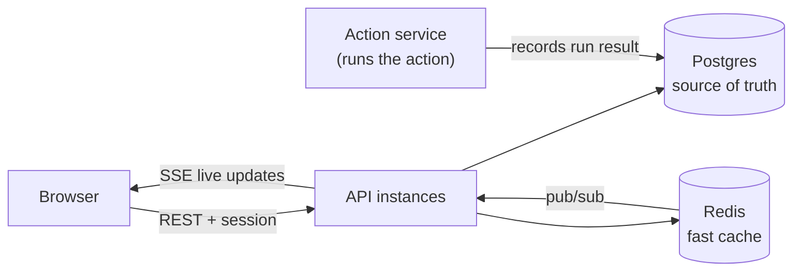
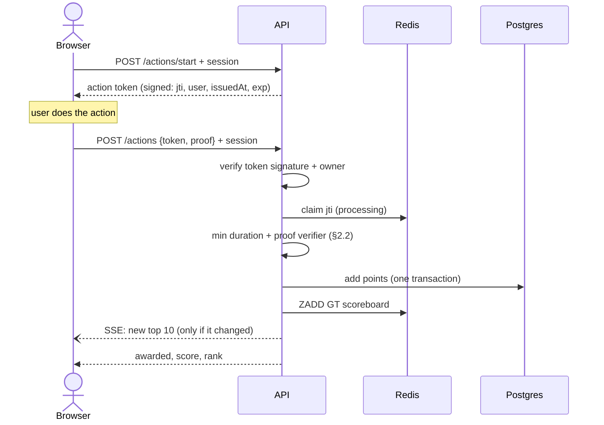
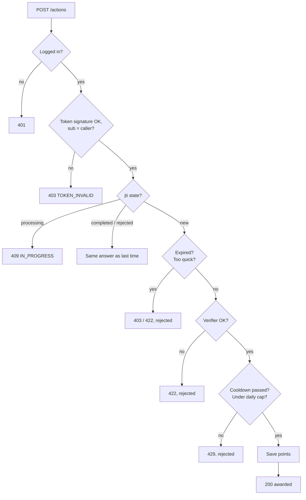
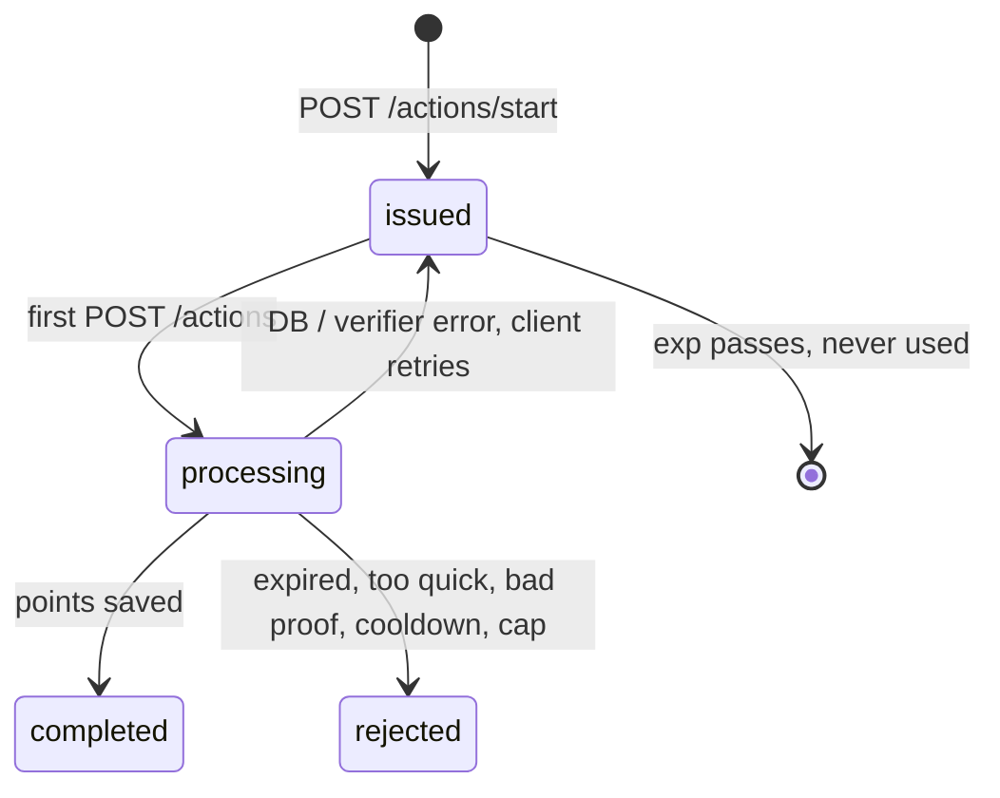
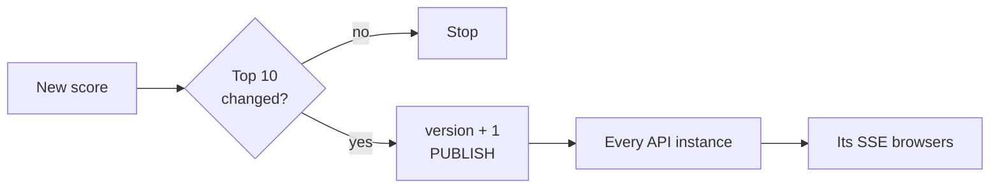

# Scoreboard Module — Specification

A backend module for the API server that stores user scores, serves the **top-10 scoreboard**, pushes **live updates** to browsers, and makes sure **nobody can raise a score without permission**.

**Companion docs:** [IMPLEMENTATION_PLAN.md](./IMPLEMENTATION_PLAN.md) (build phases) · [features/](./features/) (acceptance scenarios)
**Appendices (optional reading, no extra requirements):** [A. Reference auth design](./appendix/auth.md) · [B. Design notes](./appendix/design-notes.md) (why Redis, why SSE, Redis commands explained) · [C. Glossary](./appendix/glossary.md)

## TL;DR

| Requirement | How we meet it |
|---|---|
| Show the top 10 scores | `GET /scoreboard`, read from a Redis sorted set (§2.3) |
| Live updates | `GET /scoreboard/stream` (Server-Sent Events), pushed only when the top 10 changes (§4) |
| An action increases the score | `POST /actions/start` → server-signed, single-use **action token**; `POST /actions` with that token when done (§2.1, §2.2) |
| Block unauthorised score increases | Logged-in session, the client **never sends a score**, every award needs a token **the server issued** to that user, a minimum duration, a **server-side proof check**, cooldown + daily cap (§3) |

**The one rule to remember:** the client never says how many points it gets, and it can't start an action on its own. The server issues, checks and pays.

---

## 1. How it works



**The happy path** (each failure case is in §2.2)



**Storage roles:** Postgres is the source of truth (scores, audit log, action runs). Redis is a fast cache that can always be rebuilt from Postgres. Why Redis and why SSE: [Appendix B](./appendix/design-notes.md).

**Auth = the existing session/JWT.** The module only needs `{ userId, role }` on the request from the platform's auth middleware. Routes never take `userId` from the body or URL. A full reference design (passkeys, sessions) is in [Appendix A](./appendix/auth.md) for platforms that have none.

**In scope:** score storage and audit trail, action tokens, the completion endpoint, proof verification interface, top-10 read and live stream, anti-abuse.
**Out of scope:** what the action actually is, login itself, profile UI, frontend rendering.

---

## 2. API

All endpoints live under `/api/v1` and use JSON. Except `GET /scoreboard` and the stream, every request needs a valid session.

### 2.1 `POST /actions/start` — begin an action, get a token (logged in)

```json
// request: empty body
// response 200
{ "token": "v4.local.…", "expiresAt": "2026-10-28T10:15:00Z" }
```
The token is a **PASETO v4.local** token (encrypted + authenticated with a server key; the browser can't read or change it) holding:

| Claim | Meaning |
|---|---|
| `jti` | Random UUID. The action's ID and its idempotency key |
| `sub` | `userId` of the caller |
| `iat` / `exp` | Issued at / expires (`ACTION_TOKEN_TTL`, 10 min) |
| `kid` (footer) | Which key encrypted it, for rotation |

- Issuing is stateless: nothing is written. Rate limited like `POST /actions` (§3.3).
- `startedAt` = `iat`, signed by us, so the server knows when the action began.

### 2.2 `POST /actions` — the action finished, award points (logged in)

```json
// request
{ "token": "v4.local.…", "proof": { "runId": "…" } }
// response 200
{ "actionId": "0192f1c4-…", "awarded": 10, "score": 1240, "rank": 7 }
```
`actionId` is the token's `jti`. `rank` is `null` if the user is outside the top 10.

**Retries:** on a network error, 409 or 5xx the client resends the **same token** (with backoff), so a retry is recognised and paid once. Any other status is final.

**Points and limits — set by the server:**

| Setting | Default | Meaning |
|---|---|---|
| `ACTION_POINTS` | 10 | Points for each action |
| `ACTION_MIN_DURATION` | 3 s | Fastest humanly possible completion (`now − iat`) |
| `ACTION_TOKEN_TTL` | 10 min | How long a started action can take |
| `ACTION_COOLDOWN` | 5 s | Minimum wait between two paid actions |
| `ACTION_DAILY_CAP` | 100 | Most points a user can earn per day (UTC) |

**`proof` — the server checks the action really finished**

Every award goes through one verifier, chosen per deployment:
```ts
interface ActionVerifier {
  // Must be side-effect free and finish within 2 s.
  verify(input: { userId: string; actionId: string; startedAt: Date; proof: unknown }):
    Promise<{ ok: true } | { ok: false; reason: string }>;
}
```

| Verifier | Checks | Use when |
|---|---|---|
| `ServerRecordVerifier` (**default**) | The action service (server-side code that runs the action) wrote an `action_runs` row: same `user_id`, `action_id` = `jti`, `status = 'finished'`, `finished_at ≥ startedAt + ACTION_MIN_DURATION`. `proof.runId` must match it. | The action runs on our servers (game session, quiz, task) |
| `SignedResultVerifier` | `proof` is `{ result, sig }`, an Ed25519 signature by a trusted game server over `jti \| userId \| result`. Public keys from config, by `kid`. | The action runs on a separate trusted server |

**Failure path:** `{ ok: false }` → 422 `PROOF_REJECTED`, stored as final (§2.2 step 6). Timeout or error → 503, the claim is deleted and the client retries with the same token. There is **no** accept-all verifier: the app refuses to start without one configured.

**Every outcome of a completion:**



**Life of an action** (`action:{userId}:{jti}` in Redis):



**Server steps, in this order:**
1. Session gives `userId`. Rate limit (§3.3) → else 429 `RATE_LIMITED`.
2. Body must have a string `token` → else 400 `INVALID_REQUEST`. Unknown fields are ignored.
3. Decrypt the token with the key named by `kid`; check `iss`, `aud`, and `sub` = `userId` → else 403 `TOKEN_INVALID`. **Expiry is checked in step 5**, so a retry of an already paid token still gets its stored answer.
4. **Claim** `SET action:{userId}:{jti} processing NX EX 30`.
   - `OK` → we own it for 30 s. (After a crash it expires and the client can retry.)
   - Key exists → `processing` → 409 `ACTION_IN_PROGRESS`; otherwise return the stored response.
   - Storing a result = `SET action:{userId}:{jti} <response> EX 86400`.
5. `now > exp` → store 403 `TOKEN_EXPIRED`. `now − iat < ACTION_MIN_DURATION` → store 422 `TOO_QUICK`.
6. Verifier: `{ ok: false }` → store 422 `PROOF_REJECTED`. Timeout/error → `DEL` the claim, 503.
7. Postgres transaction (§5.1): lock the user's row, check cooldown and daily cap, insert `score_events`, add points.
   - Cooldown not passed → store 429 `TOO_FAST`. Cap hit → store 429 `DAILY_CAP`.
   - Duplicate `(user_id, action_id)` (reply lost, or Redis record gone) → success with the original `delta` and current score.
   - Other DB error → `DEL` the claim, 503.
8. After commit: flagged user → `ZREM scoreboard <userId>`; otherwise update the scoreboard (§4).
9. Store the 200 response (24 h) and return it.

A rejected token stays rejected; the next action starts with a new token.

### 2.3 `GET /scoreboard` — top 10 (public, no login)

```json
{
  "version": 48213,
  "updatedAt": "2026-10-28T10:05:12Z",
  "entries": [{ "rank": 1, "displayName": "alice", "score": 5120 }]
}
```
Served from Redis (`ZREVRANGE scoreboard 0 9 WITHSCORES` + cached display names). `version` only increases, so clients ignore older messages. Internal user IDs are never sent. No session check: the data is public and read-only; a generous per-IP rate limit is the only guard. **Ties:** equal scores are ordered by `userId` (Redis's order for equal scores), so the order is stable.

### 2.4 `GET /scoreboard/stream` — live updates (public, SSE)

```
event: scoreboard
id: 48213
data: {"version":48213,"entries":[...]}
```
- On connect: send the current top 10. Then: an event only when the top 10 changes.
- Every 25 s: `: ping` so proxies keep the connection open. Per-IP connection cap (§3.3).
- On reconnect (`Last-Event-ID`): send a fresh snapshot (it's only 10 rows).

### 2.5 Errors

Shape: `{ "error": { "code": "TOO_FAST", "message": "...", "requestId": "..." } }`

| Status | code | When |
|---|---|---|
| 400 | `INVALID_REQUEST` | Bad body |
| 401 | `UNAUTHENTICATED` | No / invalid session |
| 403 | `FORBIDDEN` | Wrong role, banned user |
| 403 | `TOKEN_INVALID` / `TOKEN_EXPIRED` | Forged, tampered or another user's token / older than `exp` |
| 409 | `ACTION_IN_PROGRESS` | Same token is `processing` right now; retry shortly |
| 422 | `TOO_QUICK` / `PROOF_REJECTED` | Finished faster than `ACTION_MIN_DURATION` / verifier said no |
| 429 | `RATE_LIMITED` / `TOO_FAST` / `DAILY_CAP` | Limit, cooldown or cap hit; includes `Retry-After` |
| 500 / 503 | `INTERNAL` / `UNAVAILABLE` | Server or dependency down; retry with the same token |

---

## 3. Security

### 3.1 Who can do what

| Route | Allowed |
|---|---|
| `GET /scoreboard`, `/scoreboard/stream` | Anyone |
| `POST /actions/start`, `POST /actions` | Active `user` or `admin` (banned users get 403 on every request) |
| `/admin/*` | `admin` who re-authenticated in the last 5 min |

**Admin endpoints** (each returns `200 { "userId", "score", "flagged", "status" }` and is written to the audit log with the admin's `userId`):

| Endpoint | Body | Effect |
|---|---|---|
| `POST /admin/users/{id}/flag` | `{ "flagged": true, "reason": "..." }` | Sets `scores.flagged`; `ZREM` (or `ZADD` back on unflag); `INCR` version + `PUBLISH` |
| `POST /admin/users/{id}/adjust` | `{ "delta": -50, "reason": "..." }` | One transaction: `score_events` row (`reason='admin'`, `action_id` NULL) + `scores` update; then a plain `ZADD` (the score may go down) |
| `POST /admin/users/{id}/ban` | `{ "reason": "..." }` | `users.status='banned'`, ends the user's sessions, flag |

### 3.2 Threats and defences

| Attack | Defence |
|---|---|
| Client sends "+1000 points" | No such field exists. Points come from server config. |
| Calling the API without logging in | Session required on every write. |
| Inventing an action without starting one | Only a token the server encrypted is accepted; forging one needs the server key. |
| Using another user's token | `sub` must equal the caller → 403. |
| Replaying a paid token | `jti` claimed once in Redis **and** `UNIQUE(user_id, action_id)` in Postgres (survives a Redis flush). |
| Finishing instantly with a script | `ACTION_MIN_DURATION` measured from the server-signed `iat`. |
| Faking the result | The verifier checks the server's own run record or a trusted signature, never the client's word. |
| Hoarding tokens, then cashing them in parallel | Cooldown checked under a row lock, so only one wins per cooldown window; tokens expire after 10 min. |
| Many fake accounts | Per-IP limits + anomaly flags; full fix in §7. |
| SSE abuse | Read-only, public data only, per-IP connection cap. |

### 3.3 Rate limits

| Route | Login? | Limit |
|---|---|---|
| `POST /actions/start`, `POST /actions` | Yes | 30/min per user, 60/min per IP (each) |
| `GET /scoreboard` | No | 300/min per IP (shared office/mobile IPs are common; the response is cheap) |
| `GET /scoreboard/stream` | No | 20 open connections per IP |

Redis token bucket on `rl:{route}:{userId|ip}`. Over the limit → 429 `RATE_LIMITED` with `Retry-After`.

**What remains:** a bot that really runs the action (passes the verifier, waits out the minimum duration) at the cooldown rate still earns points, up to the daily cap. That is bounded, traceable (`action_id`, IP, user agent on every event) and reversible. A detection job flags accounts with inhumanly regular timing or that hit the cap daily; flagged users are hidden from the top 10 until reviewed.

**Keys:** the action-token key lives in the secret manager, rotated monthly; the `kid` footer lets old tokens finish during rotation. It is separate from the session key.

---

## 4. Live updates



1. **After a score is saved**, three plain commands:
   ```
   ZADD scoreboard GT <score> <userId>   -- GT: a late, older score never overwrites a newer one
   ZREVRANK scoreboard <userId>          -- 0..9 → the user is in the top 10, so it changed
   INCR scoreboard:version + PUBLISH scoreboard:updates <version>   -- only if rank < 10
   ```
   A score only goes up, so the top 10 changes **only** if this user is in it afterwards; most writes stop at `ZREVRANK`. Admin flag/adjust/ban can lower a score, so they always `INCR` + `PUBLISH`.
2. Every API instance subscribes to `scoreboard:updates`. On a message it reads the **current** top 10 itself (`ZREVRANGE` + cached names) and sends it to its own SSE clients. No sticky sessions needed.
3. Each instance sends at most one event per 500 ms and runs one read at a time. Every read fetches the latest data, so a late message can never show an old top 10. Clients drop events with a lower `version`.
4. **Safety net:** pub/sub is fire-and-forget, so every 10 s each instance compares `scoreboard:version` with the last version it sent and resends if behind.
5. Display name change of a top-10 user: update `user:name:{userId}`, `INCR` + `PUBLISH`.

---

## 5. Data model

### 5.1 Postgres

```sql
-- users is owned by the existing auth system; this module reads these columns
--   users(id uuid PK, display_name text UNIQUE, role text, status text)

CREATE TABLE scores (
  user_id        uuid PRIMARY KEY REFERENCES users(id),
  score          bigint NOT NULL DEFAULT 0 CHECK (score >= 0),
  flagged        boolean NOT NULL DEFAULT false,
  last_action_at timestamptz,                 -- for the cooldown
  updated_at     timestamptz NOT NULL DEFAULT now()
);

-- append-only audit log: the app's DB role has no UPDATE/DELETE here
CREATE TABLE score_events (
  id          bigserial PRIMARY KEY,
  action_id   uuid,                          -- the token's jti; NULL for admin adjustments
  user_id     uuid NOT NULL REFERENCES users(id),
  delta       integer NOT NULL,              -- corrections are negative rows
  reason      text NOT NULL DEFAULT 'action',
  created_at  timestamptz NOT NULL DEFAULT now(),
  ip          inet,
  user_agent  text,
  UNIQUE (user_id, action_id)
);
CREATE INDEX ON score_events (user_id, created_at);

-- written by the action service, read by ServerRecordVerifier (§2.2)
CREATE TABLE action_runs (
  action_id   uuid PRIMARY KEY,              -- = token jti
  user_id     uuid NOT NULL REFERENCES users(id),
  status      text NOT NULL CHECK (status IN ('running','finished','failed')),
  started_at  timestamptz NOT NULL,
  finished_at timestamptz
);
```

Completion transaction:
```sql
BEGIN;
-- 1. lock the user's row: their completions run one at a time, so cooldown and cap can't race
INSERT INTO scores (user_id) VALUES ($2) ON CONFLICT DO NOTHING;
SELECT flagged, last_action_at FROM scores WHERE user_id = $2 FOR UPDATE;
-- 2. cooldown: app does ROLLBACK + 429 TOO_FAST if now() - last_action_at < ACTION_COOLDOWN
-- 3. daily cap (UTC day): app does ROLLBACK + 429 DAILY_CAP if used + $3 > ACTION_DAILY_CAP
SELECT coalesce(sum(delta), 0) AS used FROM score_events
 WHERE user_id = $2 AND reason = 'action'
   AND created_at >= date_trunc('day', now() AT TIME ZONE 'UTC') AT TIME ZONE 'UTC';
-- 4. award
INSERT INTO score_events (action_id, user_id, delta, ip, user_agent)
VALUES ($1,$2,$3,$4,$5);                    -- duplicate (user_id, action_id) → §2.2 step 7
UPDATE scores SET score = score + $3, last_action_at = now(), updated_at = now()
 WHERE user_id = $2 RETURNING score, flagged;
COMMIT;
```

### 5.2 Redis

| Key | Purpose |
|---|---|
| `action:{userId}:{jti}` | `processing` (30 s, `NX`), then the stored response (24 h) |
| `scoreboard` | Sorted set `userId → score`, unflagged users only |
| `scoreboard:version` | Version counter, bumped when the top 10 changes |
| `user:name:{userId}` | Display name cache |
| `rl:*` | Rate limit counters |

### 5.3 Keeping Redis and Postgres in sync

- `ZADD GT` the **absolute** score returned by Postgres (not `ZINCRBY`), so retries can't double count and late writes can't roll a score back.
- If Redis fails after the DB commit, points are safe. A rebuild job (startup + every 5 min) loads `scores WHERE NOT flagged` into a temp key, then `RENAME`s it over `scoreboard`.
- Scores are stored raw, so they stay exact up to 2^53.

### 5.4 Failure modes

| Failure | Behaviour |
|---|---|
| **Redis down** | `POST /actions*` return 503 (fail closed: no claim, no rate limit). `GET /scoreboard` reads Postgres with a 5 s cache. SSE sends only pings. |
| Postgres down | `POST /actions` returns 503 and deletes the claim; the client retries with the same token. |
| **Duplicate delivery** (retry, double click, LB resend) | Same `jti` → the Redis claim returns 409 or the stored answer; if Redis lost it, `UNIQUE(user_id, action_id)` turns it into the original success. Paid once. |
| **Duplicate delivery** (pub/sub message twice) | Harmless: the instance re-reads the same top 10, and clients drop a repeated `version`. |
| **Out-of-order events** (two `ZADD`s for one user) | `ZADD GT` keeps the higher score; the older write is a no-op. |
| **Out-of-order events** (SSE / pub/sub) | Instances always read the current top 10, never the message payload; clients drop events with a lower `version`. |
| Pub/sub message lost | The 10 s version poll resends within 10 s. |
| Instance dies mid-`processing` | The 30 s lease expires and the same token can be retried. |

---

## 6. Non-functional requirements

**Scaling:** API instances are stateless; issuing a token touches no storage. ~10k SSE connections per Node instance; LB idle timeout must exceed the 25 s ping. Sorted-set ops are O(log N). Partition `score_events` by month when large.

**Observability:** metrics `actions_started_total`, `actions_completed_total{result}`, `rejections_total{code}`, `verifier_latency_seconds`, `scoreboard_broadcasts_total`, `sse_connections`, p95 of `POST /actions`. Logs carry `requestId`, `userId`, `actionId`; tokens are never logged. Alert on spikes in `TOKEN_INVALID`, `TOO_QUICK`, `PROOF_REJECTED`, and on Redis/DB drift.

**Acceptance checklist:**
- [ ] No endpoint or field lets the client choose the points.
- [ ] No session → 401; banned user → 403.
- [ ] Tampered token, token from another user → 403 `TOKEN_INVALID`; expired → 403 `TOKEN_EXPIRED`.
- [ ] Completing faster than `ACTION_MIN_DURATION` → 422 `TOO_QUICK`; retrying later still returns 422.
- [ ] No `action_runs` row, wrong user, or not `finished` → 422 `PROOF_REJECTED`. Verifier timeout → 503, retry works.
- [ ] App refuses to start without a configured verifier.
- [ ] 50 concurrent requests with one token → exactly one `score_events` row.
- [ ] 20 tokens cashed in at once by one user → one award, the rest 429 `TOO_FAST`.
- [ ] Over rate limit / daily cap → 429 with `Retry-After`.
- [ ] Reply dropped after commit → the retry returns the same 200, one row, even after a Redis flush.
- [ ] A flagged user who completes an action does not appear in the top 10.
- [ ] Out-of-order `ZADD`s for one user → Redis holds the higher score.
- [ ] `GET /scoreboard` matches `SELECT … WHERE NOT flagged ORDER BY score DESC, user_id DESC LIMIT 10`; no public response has a `userId`.
- [ ] SSE: snapshot on connect, event within 1 s of a top-10 change, nothing for changes outside it, works across 2+ instances.
- [ ] Flushing Redis + rebuild restores the same top 10.
- [ ] Load: 500 completions/s at p95 < 150 ms; 10k SSE clients per instance.

---

## 7. Improvements and later phases

1. **Per-action-type rules:** add an `actionType` to `/actions/start` and the token, with its own points, minimum duration and verifier.
2. **Fake accounts (Sybil):** email/phone verification, CAPTCHA on `/actions/start` when suspicious, device fingerprinting.
3. **Outbox pattern:** write a `scoreboard_outbox` row in the completion transaction and let a worker update Redis. Closes the "DB committed, Redis failed" gap (today healed by the rebuild job).
4. **Auth hardening** (if the platform has no strong login yet): passkeys, server-side sessions, device-bound cookies. See [Appendix A](./appendix/auth.md).
5. **Time-boxed leaderboards** (daily/weekly): one sorted set per period with a TTL.
6. **Personal rank:** `ZREVRANK` to show "you are #1,532".
7. **Huge audiences:** move SSE fan-out to a managed pub/sub or CDN streaming service.
8. **First to reach wins on ties:** store `reached_at`, read the top ~50 from Redis, sort ties by `reached_at` in the API.
