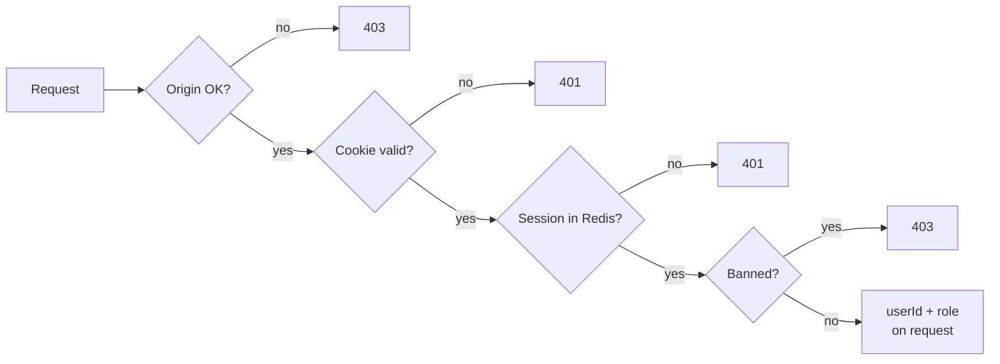

# Appendix A — Reference auth design

> **Optional.** The spec assumes the platform already has login and sessions ("auth = existing session/JWT"). Use this design only if it has none. Section numbers like §2.1 refer to [../README.md](../README.md).

- **Login:** Passkeys (WebAuthn), via a maintained library such as `@simplewebauthn/server`. No passwords → no phishing, no credential stuffing. Endpoints: `POST /auth/{register|login}/{options|verify}`, `POST /auth/logout`, `POST /auth/logout-all`. Challenges are random, stored in Redis for 5 min, and used once (`GETDEL`).
- **Session:** on login the server creates a random `sid`, stores `session:{sid}` → `{userId, role, amr, authTime, createdAt}` in Redis, and sets a cookie holding a **PASETO v4.local** token (`iss`, `aud`, `sub`, `sid`, `exp`):
  ```
  Set-Cookie: __Host-session=v4.local.…; Path=/; Secure; HttpOnly; SameSite=Strict; Max-Age=1800
  ```
  - `HttpOnly` → JavaScript cannot steal it (XSS). `SameSite=Strict` + Origin check → no CSRF.
  - Cookie and token both live 30 min (= the idle timeout) and are re-issued while the user is active. No session lives past 12 h from login.
  - Why encrypt a token around a random `sid`? Forged or garbage cookies are rejected locally, before any Redis call.
  - The Redis record means **logout and role change take effect immediately** (delete the `sid`). A ban also adds the user to `banned_users`, which is checked on every request, so the ban holds even if deleting a session fails.
- **Fallback logins** (optional, for users without passkeys): OAuth/OIDC with PKCE, and email magic links. These sessions **cannot** do admin or account-security actions. Details below.

## Middleware (every protected route, in order)



1. For `POST/PUT/PATCH/DELETE`: `Origin` must be in the allow-list → else 403.
2. Read `__Host-session` → missing = 401.
3. Decrypt/verify PASETO; check `iss`, `aud`, `exp` → else 401.
4. Load `session:{sid}` from Redis → missing / `sub` ≠ session user / older than 12 h = 401.
5. `SISMEMBER banned_users <userId>` → 403 `FORBIDDEN`.
6. Refresh the session's 30 min idle TTL; re-issue the cookie if < 15 min left.
7. Put `{userId, role}` on the request. **Routes never take `userId` from the body or URL.**

## Fallback logins (optional)

- *OAuth/OIDC* (Google/Apple/GitHub): Authorization Code + PKCE, `state` bound to a cookie, verify ID token `iss/aud/exp/nonce`. Key accounts on `(provider, sub)`; never auto-link by email.
- *Email magic link*: 32-byte token in the URL fragment, only its hash stored, single use, 15 min, redeemed by POST. Same 202 response for known/unknown emails.
- *Account recovery:* allow multiple passkeys and one-time recovery codes.
- *Device-bound sessions (DBSC):* bind the cookie to the device once browser support is broad.

**Keys:** the PASETO key is stored in the secret manager and rotated monthly (identified by `kid`).

## Who can do what (extra rules with this design)

- `/admin/*` needs an admin whose session `amr` includes passkey and whose `authTime` is under 5 min old → else 403 `REAUTH_REQUIRED`.
- A ban also `SADD banned_users <userId>` (checked in step 5 above) and deletes every `session:{sid}` in `user:sessions:{userId}`.

## Extra storage

```sql
-- adds to the platform's users table
ALTER TABLE users ADD COLUMN webauthn_id bytea NOT NULL UNIQUE;  -- random, never the uuid or email

CREATE TABLE passkey_credentials (
  credential_id bytea PRIMARY KEY,
  user_id       uuid NOT NULL REFERENCES users(id) ON DELETE CASCADE,
  public_key    bytea NOT NULL,
  sign_count    bigint NOT NULL DEFAULT 0,
  created_at    timestamptz NOT NULL DEFAULT now(),
  last_used_at  timestamptz
);
```

| Redis key | Purpose |
|---|---|
| `session:{sid}` / `user:sessions:{userId}` | Session record / all sessions of a user (for logout-all, ban) |
| `banned_users` | Set of banned user IDs, checked on every request |
| `webauthn:chal:{id}` | Login challenge, 5 min, used once (`GETDEL`) |

## Scenarios

[login-with-passkey.feature](./features/login-with-passkey.feature) · [session-protection.feature](./features/session-protection.feature)
