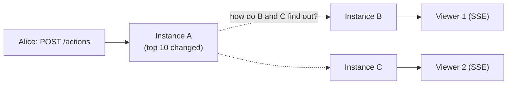

# Appendix B — Design notes

> **Background reading.** Why the main choices in [../README.md](../README.md) were made, and what the Redis commands do. Nothing here adds requirements.

## Why Redis, not just querying Postgres?

Postgres alone *could* serve the top 10: `SELECT … WHERE NOT flagged ORDER BY score DESC LIMIT 10` with an index on `score` is fast. We still add Redis because of how the scoreboard is used, not because of that one query:

| Need | Postgres only | With Redis |
|---|---|---|
| Read the top 10 on every page view and every SSE reconnect | One query each time; read load grows with visitors | `ZREVRANGE` from memory, sub-ms, no DB load |
| After each score write, check "did the top 10 change?" | A second query per write | `ZREVRANK` on the sorted set, O(log N) (README §4) |
| Tell every API instance about a change | `LISTEN/NOTIFY` works, but holds a DB connection per instance and has payload limits | Built-in pub/sub |
| Short-lived state: action claims, rate limits | Extra tables, cleanup jobs, row churn on hot paths | Native TTLs, `SET NX` |
| Keep the DB for writes | Every read competes with the completion transaction | Reads never touch Postgres |

**Trade-offs we accept:**
- One more system to run and monitor.
- Redis and Postgres can drift. Postgres stays the **source of truth**: Redis gets the absolute score (`ZADD GT`), and a rebuild job re-syncs it every 5 min (README §5.3).
- Redis is not durable storage. Losing it loses no points, only cached state (open action claims are retried and the DB unique key prevents a double award).
- If Redis is down, writes fail closed and reads fall back to Postgres (README §5.4).

**When to skip Redis:** a single instance with low traffic. Postgres with the index above plus an in-process cache is enough, and the rest of this spec still applies.

## Why Server-Sent Events, not WebSocket?

| | SSE (chosen) | WebSocket | Polling `GET /scoreboard` |
|---|---|---|---|
| Direction | Server → browser | Both ways | Browser asks |
| What we need | Push the top 10 to viewers; they never send anything back | Unused half | Works, but always late or wasteful |
| Protocol | Plain HTTP response | Upgrade to a separate protocol | Plain HTTP |
| LB, proxies, CDN, auth | Work as-is | Need upgrade support and longer timeouts; own auth handshake | Work as-is |
| Reconnect | Built into `EventSource`, sends `Last-Event-ID` | Write it yourself | N/A |
| Server cost | One open connection per viewer, idle unless the top 10 changes | Same, plus per-message framing and ping/pong | A request every N seconds per viewer, even with no change |
| Latency | Under 1 s | Under 1 s | Up to N seconds |
| Limits | Text only; max 6 connections per domain on HTTP/1.1 (none on HTTP/2) | Binary support; no per-domain cap | — |

**Why SSE wins here:** the data flows one way, it is small (10 rows), and it is public. SSE gives live updates with the least new infrastructure and free reconnects. Scores are still sent with normal `POST` requests, which already have session, Origin check and rate limits.

**Trade-offs we accept:**
- Each viewer holds an open connection. We cap connections per IP and send a ping every 25 s so proxies keep it open.
- Browsers on HTTP/1.1 allow 6 connections per domain, so many tabs can starve each other. Serve the API over HTTP/2.
- No client → server channel. That is fine today.

**When to switch to WebSocket:** if the page needs to send frequent messages back (chat, real-time game input), or binary data. Polling stays a fallback for clients that cannot keep a connection open.


## Why pub/sub, and not just `GET`?

**The problem.** We run several API instances behind a load balancer. Each browser's SSE connection is held open by **one** instance. A score change, though, is handled by **whichever** instance got the `POST /actions`:



Instance A knows the top 10 changed. B and C don't, yet their viewers need the update. Something has to tell them.

**Option 1: poll with `GET`.** Each instance runs `GET scoreboard:version` every N ms and sends an update if the number went up.
- Waits up to N ms before a viewer sees the change. Small N = many useless calls; large N = slow updates.
- Calls Redis all the time, even when nothing changes (which is most of the time).

**Option 2: pub/sub (chosen).** Each instance opens one connection at startup and runs `SUBSCRIBE scoreboard:updates`. When a write runs `PUBLISH scoreboard:updates <version>`, Redis **pushes** that message to every subscribed instance at once. Each instance then reads the top 10 (`ZREVRANGE`) and sends the result to its own SSE viewers.
- Updates arrive within milliseconds.
- No Redis traffic while nothing changes.
- Any instance can handle any request, so no sticky sessions are needed.

So pub/sub is only the **"something changed, version N"** signal. The data itself is still read with a plain read.

**The catch:** Redis pub/sub is fire-and-forget. If an instance is disconnected at the moment of the `PUBLISH`, it misses the message, and Redis doesn't store it. That's why we **also** keep a slow poll: every 10 s each instance checks `scoreboard:version` and catches up if it is behind (README §5.4). Pub/sub gives speed; the poll is the safety net.

| | Poll with `GET` only | Pub/sub + slow poll (chosen) |
|---|---|---|
| Delay to viewer | Up to the poll interval | Milliseconds |
| Redis load when idle | Constant | One idle connection per instance |
| Missed updates | None | Possible, fixed within 10 s by the poll |

**With a single instance** none of this is needed: the instance that saves the score can send to its own viewers directly.

---

## Redis commands used

**What `ZREVRANGE` does:** `scoreboard` is a sorted set, where Redis keeps every `userId` ordered by its score. `ZREVRANGE` reads a slice of it from the **highest** score down (`REV` = reverse; plain `ZRANGE` goes lowest first). `0 9` = positions 0 to 9, so the top 10. `WITHSCORES` returns each score next to its member:
```
> ZREVRANGE scoreboard 0 9 WITHSCORES
1) "user-a"   2) "5120"
3) "user-b"   4) "4980"
...
```
The set is already sorted, so this costs O(log N + 10): fast even with millions of users, and no sorting at read time.

**What `ZREVRANK` does:** returns one member's position in the sorted set, counting from the **highest** score (`REV` = reverse; plain `ZRANK` counts from the lowest). Positions start at 0, so 0 = first place and 9 = tenth. It returns `nil` if the member is not in the set (e.g. flagged users):
```
> ZREVRANK scoreboard user-b
(integer) 1          -- second place → in the top 10
```
Like `ZREVRANGE`, it costs O(log N), so checking it on every write is cheap.
